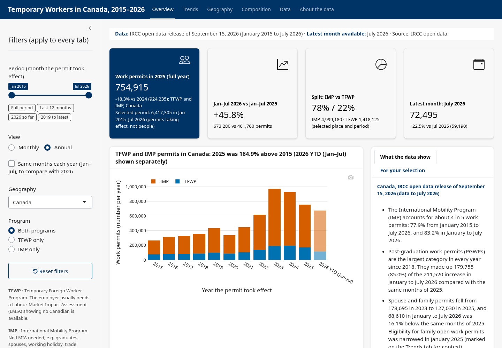
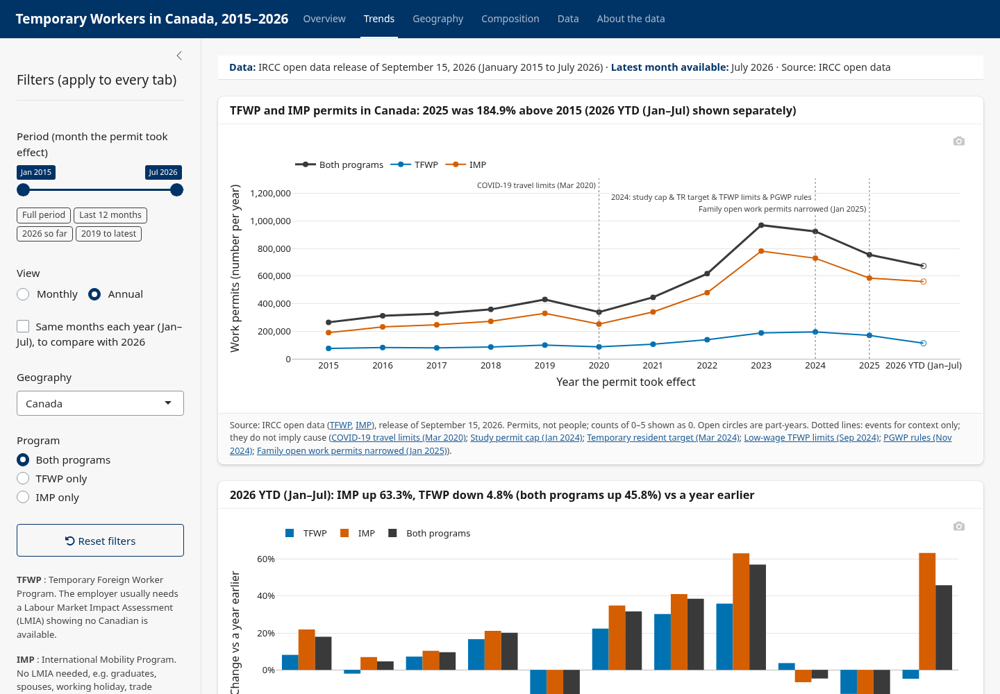

# Temporary Workers in Canada: R Shiny dashboard (ECON 24R, Question 1)

An interactive dashboard of temporary work permits by province/territory and program (TFWP and IMP), from January 2015 to the latest month IRCC has published.

**Live dashboard:** https://mohsenfazeli.shinyapps.io/temporary-workers-dashboard/ (the first visit can take up to a minute while the server wakes up).




## Run it locally
1. Install R (4.3 or newer; built with 4.5.0) from https://cloud.r-project.org. RStudio is optional.
2. Clone or download this repository and open R in its folder (in RStudio: open the folder, or `setwd()` to it).
3. Start the app: `shiny::runApp()` (if the shiny package isn't installed yet, run `install.packages("shiny")` first). A browser tab opens. On first run every script installs any missing packages itself from CRAN as ready-made binaries, so no compiler (e.g. Rtools on Windows) is needed.
4. Optional, only if you want the exact package versions used to build it: `install.packages("renv"); renv::restore()`. This can take much longer, and on Windows it may need Rtools if an exact version is only available as source code.

By default the app shows a fixed IRCC release: the two IRCC files as published on September 15, 2026 (January 2015 to July 2026), saved in `data/baseline.rds`. The header says "Data: IRCC open data release of September 15, 2026". The date is IRCC's own: the files' Last-Modified date on the IRCC server and the "date modified" in the Open Government catalogue, both checked on October 18, 2026. Every visitor sees the same numbers, so the figures match the written notes.

Live refresh is an option for maintainers: start the app with `TW_DATA_SOURCE=live` and it downloads the IRCC files at startup. If the IRCC website can't be reached, IRCC changes its file layout, or a download does not match the verified copy for months older than 12 months, the app uses the saved copy in `data/cache.rds` and says so in the header. The cache is only overwritten by a download that passes every check.

## Data
Main data (Open Government Licence – Canada; saved as the September 15, 2026 release, or read live with `TW_DATA_SOURCE=live`):
- https://www.cic.gc.ca/opendata-donneesouvertes/data/ODP-TR-Work-TFWP-PT_program.csv
- https://www.cic.gc.ca/opendata-donneesouvertes/data/ODP-TR-Work-IMP-PT_program.csv

No other data source is used: every figure in the dashboard comes from these two IRCC CSV files.

How the data are handled:
- The date range, year list and latest month are taken from the data, so a new IRCC month appears without code changes.
- Values IRCC suppresses for privacy ("--", 0–5) count as 0 and are flagged; figures where they could add more than 10% are marked "Possible undercount".
- Counts are permits that took effect, not people or new arrivals; they include permits for people already in Canada (extensions and changes of status), so they can rise while arrivals fall (IRCC, Supplementary Information for the 2026–2028 Immigration Levels Plan).
- Dotted lines on the Trends charts mark six dated policy events, each linked to its official Government of Canada source. They are context only and do not imply cause.
- "Same months each year" (Annual view) compares January to July of every year with 2026.

## Structure
- `app.R`: page layout, global sidebar controls, header status bar; loads the data once at startup.
- `R/data.R`: `load_release()` (default: the dated IRCC release) and `load_data()` (live read, checks, tidy table, cache fallback).
- `R/calc.R`: calculation and formatting functions, all tested.
- `R/theme.R`: colours (colour-blind safe), chart styling, source lines.
- `R/mod_*.R`: one module per tab (Overview, Trends, Geography, Composition, Data, About).
- `www/styles.css`: government-style visual tweaks.
- `data/cache.rds`: offline fallback (IRCC data as downloaded on October 16, 2026; replaced on the server only by a download that passes every check).
- `data/baseline.rds`: the IRCC release of September 15, 2026 that the app shows by default (date in `RELEASE_INFO`, `R/data.R`); never overwritten. Each new download is compared with it for settled months (at least 12 months before its latest month); if more than 2% of cells or any full-year Canada program total (more than 1%) differ, the download is treated as damaged. Refresh it with `tools/build_cache_and_profile.R` when you redeploy with a newer verified release, and update `RELEASE_INFO` to IRCC's date for that release.
- `data_profile.md`: data profile, checks and assumptions.
- `tests/`: testthat and shinytest2 tests.
- `tools/get_testdata.R`: downloads the two IRCC CSV files into `testdata/` for the tests.
- `tools/build_cache_and_profile.R`: rebuilds `data/cache.rds` from local copies of the IRCC files in `raw_profile/` (not included; download them first).
- `tools/deploy.R`: publishes to shinyapps.io using the `SHINYAPPS_ACCOUNT`, `SHINYAPPS_TOKEN` and `SHINYAPPS_SECRET` environment variables.
- `renv.lock`: exact package versions.

## Tests
```
Rscript tools/get_testdata.R          # one-off: local copies of the IRCC files
NOT_CRAN=true Rscript tests/testthat.R
```
- The browser tests need Google Chrome or Chromium.
- The live test reads IRCC directly and skips with a message if IRCC can't be reached.
- The performance tests time the app starting from the saved copy (`data/cache.rds`; target under 10 s) and filter changes (median under 1 s, none over 2 s). A live start also downloads about 17 MB from IRCC, so it takes longer on a slow connection.
- `tests/testthat.R` exits with status 1 if any test fails or stops with an error; `Rscript tools/windows_check.R` runs everything and prints ALL CHECKS PASSED only when there are 0 failures and 0 errors.

## Optional settings (environment variables)
- `TW_DATA_SOURCE`: `live` downloads the IRCC files at startup instead of showing the saved release (default).
- `TW_LOCAL_DIR`: read local copies of the two IRCC CSV files instead of the URLs (same code path as live).
- `TW_TIMEOUT`: download timeout in seconds per file once the server has answered (default 60). Before downloading, the app checks in parallel that each IRCC server answers (6-second connect limit), so an unreachable site falls back to the cache in about 6 seconds.
- `TW_TRIES`: download attempts (default 2).
